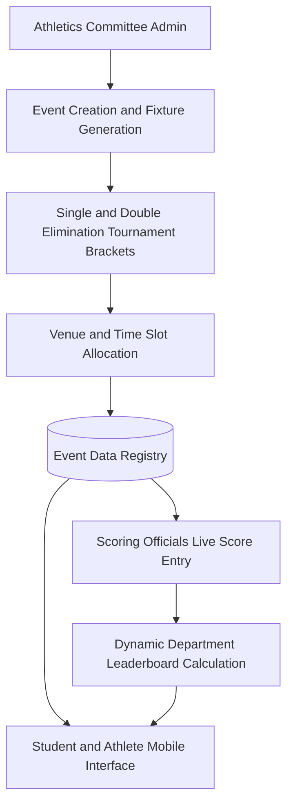

# Ahalia Sports Bot

<div align="center">

[](https://flutter.dev)
[](https://dart.dev)
[](https://flutter.dev)
[](LICENSE)

</div>

A campus sports event coordination and tournament management mobile application built for Ahalia college athletics. Provides live match fixture scheduling, department scoring tables, and athlete registries.

---

## Event Management Pipeline



---

## Features

- **Tournament Bracket Generation**: Automated round-robin and knockout tournament scheduling for college sports.
- **Live Scoreboard Updates**: Real-time point tracking for football, cricket, badminton, and track events.
- **Departmental Point Standings**: Cumulative points calculation across academic departments for overall trophies.
- **Athlete Registration**: Direct verification of student participants by department and college ID.
- **Venue and Schedule Notifications**: Clear timetable tracking venue, court assignment, and start times.

---

## Tech Stack

| Component | Technology |
| :--- | :--- |
| Frontend | Flutter (Dart) |
| Architecture | Feature-First Clean Separation |
| State Management | Provider |
| Persistence | Local Storage & REST API Integrations |

---

## Getting Started

1. Clone the repository:
   ```bash
   git clone https://github.com/Midhun-M-git/ahalia_sports_bot.git
   cd ahalia_sports_bot
   ```

2. Install dependencies:
   ```bash
   flutter pub get
   ```

3. Launch on device or emulator:
   ```bash
   flutter run
   ```

---

## License

This project is licensed under the MIT License. See the [LICENSE](LICENSE) file for details.
